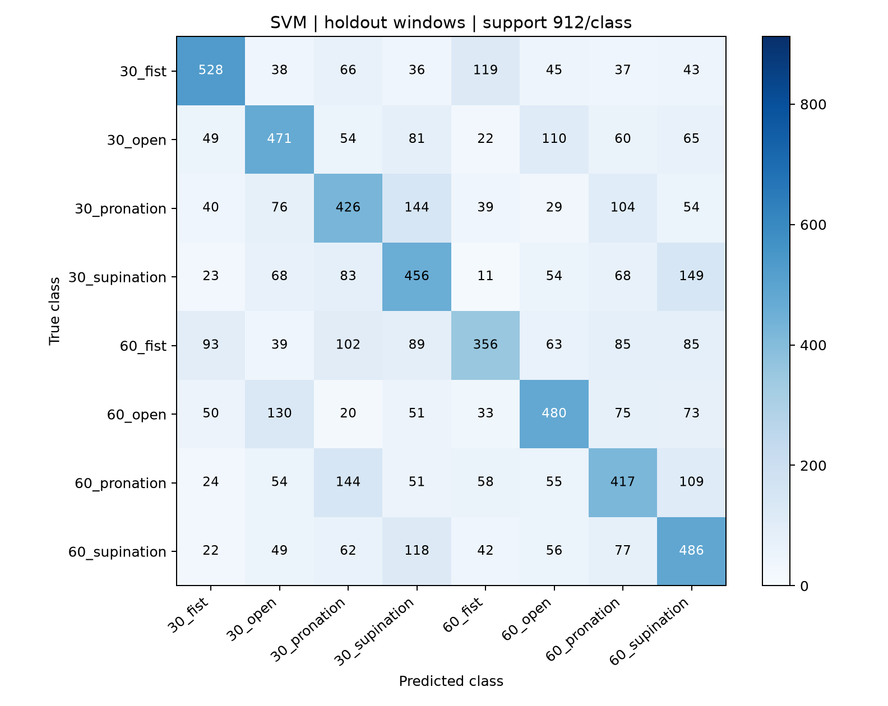
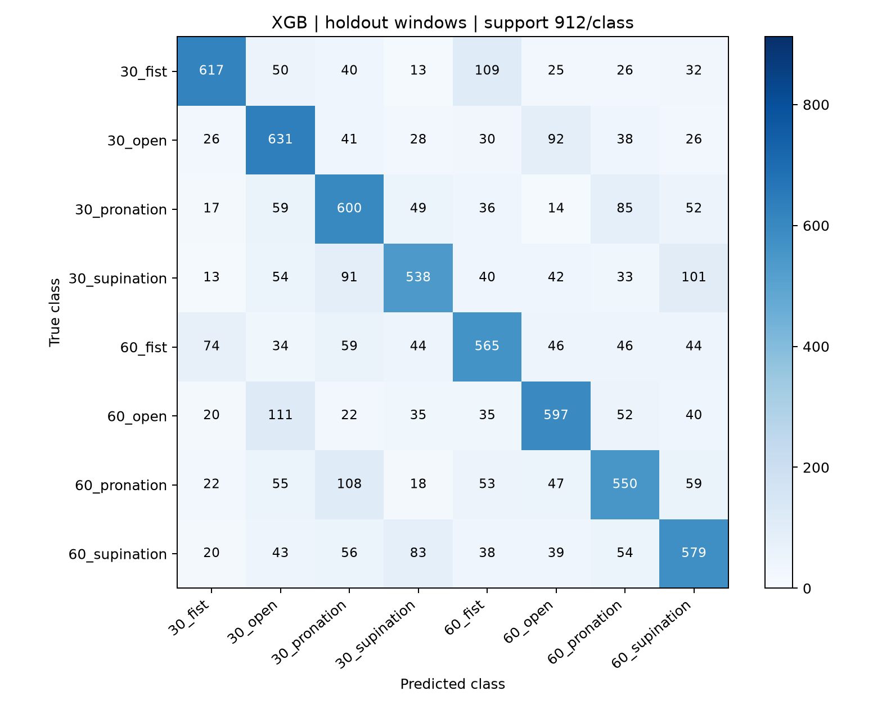
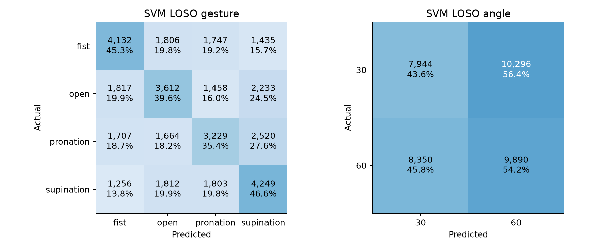
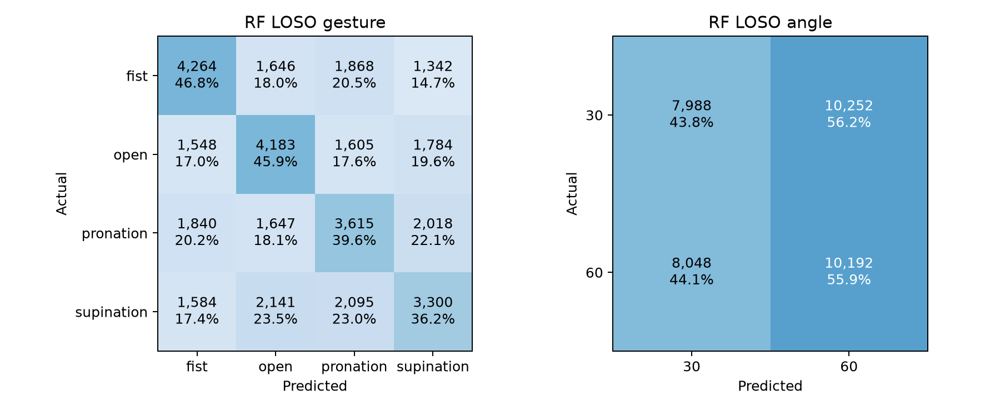

# AI 모델 재현 및 성능 비교

[최종 보고서 PDF](reports/submission_revised/Step2_final_revised_with_LOSO_OhSeongbin.pdf) · [편집용 Word](reports/submission_revised/Step2_final_revised_with_LOSO_OhSeongbin.docx)

[1주차](reports/week1/README.md) · [2주차](reports/week2/Step2_week2_report_OhSeongbin.pdf) · [3주차](reports/week3/README.md) · [LOSO 실험 파일](outputs/loso/README.md)


## sEMG 손동작과 팔꿈치 각도 분류

오성빈

8명의 5채널 근전도에서 손동작 4종과 팔꿈치 각도 2종을 조합한 8클래스를 예측했다. 동일한 특징과 시행 분할에서 SVM, Random Forest, XGBoost를 비교하고, 저장된 예측의 시행별 집계와 피험자 제외 평가로 결과의 적용 범위를 확인했다.

### 결과 한눈에 보기

|평가 조건|모델|정확도|해석|
|---|---|---|---|
|학습 시행 5 fold|RF|63.40 ± 1.04%|기존 학습 자료 안의 검증|
|기존 테스트 7,296창|RF|65.87%|같은 사람의 다른 시행|
|기존 테스트 384시행 투표|RF|96.09%|2초 구간을 모아 판단|
|동일 테스트 창 LOSO|RF|23.08%|학습에서 제외한 사람|
|동일 테스트 시행 LOSO 투표|RF|31.51%|제외한 사람의 시행 판단|

위 수치는 서로 다른 평가 조건이다. 96.09%는 단일 창 성능이나 새로운 사람에 대한 성능이 아니다. LOSO는 기존 자료를 재구성한 사후 탐색 실험이며 독립적인 새 측정 검증은 아니다. 교차검증의 ±는 5개 fold의 SD로 ddof=0이다.

### 보고서 구성

1 코드 설명에서는 데이터 흐름과 실제 실행 절차를, 2 모델 성능 비교에서는 평가 방식과 비용을, 3 Confusion Matrix 분석에서는 오류의 위치와 비중을 설명한다. 4 최종 결과에서 확인한 사실과 한계를 연결한 뒤 LOSO 실험 보고서 8쪽 전체를 이어 수록한다.

## 1 코드 설명

### 사용한 데이터와 전처리 방법

8명의 피험자가 손동작 4종과 팔꿈치 각도 2종을 수행한 64개 연속 기록을 사용했다. 신호는 1,000Hz의 5채널이며 ECR, ED, FDS, Biceps, Triceps에 대응한다. 파일 하나는 단일 시행이 아니라 30개 마커를 포함한다. 총 1,920시행, 클래스당 240시행을 확인했다.

정답은 30도 및 60도와 주먹 쥐기, 손 펴기, 회내, 회외를 조합한 8클래스다. pro는 회내, extor는 회외로 해석했다. 8클래스는 8개 센서 채널을 뜻하지 않는다.

공개 신호에는 60Hz 노치 및 20~450Hz 4차 Butterworth 필터가 이미 적용되어 있다. 기본 학습 자료에는 추가 필터를 적용하지 않았다. 2주차의 필터 비교는 공개 신호에 필터를 다시 적용한 실습이며 무필터 원신호와의 비교가 아니다.

마커 기준 1.5~3.5초를 잠정 분석 구간으로 설정했다. 200ms 창과 50% 중첩으로 시행당 19창을 만들고, 각 채널에서 RMS, MAV, WL, ZC, SSC를 추출하여 25차원 특징을 구성했다. ZC에는 차이 임계값 0.01을 사용하고 SSC에는 진폭 문턱값을 적용하지 않았다.

|구분|시행 수|창 수|특징 수|
|---|---|---|---|
|학습|1,536|29,184|25|
|테스트|384|7,296|25|
|전체|1,920|36,480|25|

200ms는 짧은 구간의 근활성 특징과 시간 변화를 함께 관찰하기 위한 설정이며 최적값으로 검증된 것은 아니다. 50% 중첩은 100ms 간격으로 판단을 갱신하지만 창끼리 상관을 만든다. 마커와 실제 동작 시작의 정렬은 미확인이다.

## 1 코드 설명

### 사용한 모델과 학습 및 테스트 방법

|모델|주요 설정|
|---|---|
|SVM|RBF, C=1.0, gamma=scale, decision_function_shape=ovr|
|Random Forest|100 trees, random_state=42, n_jobs=4|
|XGBoost|400 trees, max_depth=6, learning_rate=0.05, subsample=0.9, colsample_bytree=0.8, seed=42, CPU hist|

시행 ID를 먼저 클래스 층화 80 대 20으로 분할하고 그다음 창을 생성했다. 동일 시행의 창이 학습과 테스트에 함께 포함되지 않도록 했다. StandardScaler는 학습 자료에만 fit했다. 세 모델에 동일 분할을 적용했으며 테스트 점수로 설정을 재조정하지 않았다.

교차검증은 학습 시행 1,536개를 5개 fold로 나눈 뒤 해당 시행의 창으로 확장했다. 각 fold 내부에서 표준화와 모델 학습을 수행했다. 기존 평가는 같은 피험자의 다른 시행을 포함하므로 새 피험자 일반화 평가와는 구분한다.

### 실행 방법

```bash
git clone https://github.com/TestUser-alt-dev/sEMG-Hand-Gesture-Elbow-Angle-Dataset data/source
python -m pip install -r requirements-week3.txt
python week2.py
python analyze_stability.py
python week3.py
python -m unittest -v test_week2 test_week3
python verify_week3.py
```

프로젝트 루트에서 실행한다. 원자료는 data/source/data에 둔다. 기존 결과가 있는 경우 검증 명령으로 저장된 예측과 지표를 확인할 수 있다.

### 코드 파일별 역할

|파일|설명|
|---|---|
|week2.py|마커와 시행 분할, 창 생성, 25개 특징, 표준화|
|analyze_stability.py|분석 구간과 기록 시간에 따른 특징 변화|
|week3.py|모델 구성, 학습, 교차검증, 성능과 시간 평가|
|verify_week3.py|저장된 예측 및 성능 지표의 일치 검증|
|test_week2.py / test_week3.py|특징과 분할 및 평가 관련 단위 검사|
|week2_preprocessing.ipynb|전처리 실습과 실행 결과|
|week3_model_comparison.ipynb|모델 비교 실습과 실행 결과|

## 1 코드 설명과 재현 범위

### 입력부터 평가까지의 처리 흐름

64개 CSV → 마커 상승점과 시행 ID → 시행 단위 층화 분할 → 1.5~3.5초 추출 → 200ms 창 19개 → 시간영역 특징 25개 → 학습 자료로 표준화 → 모델 학습 → 고정된 테스트 예측 → 지표와 혼동행렬 저장.

### 특징이 표현하는 정보

|특징|계산과 해석|
|---|---|
|RMS|제곱평균의 제곱근으로 신호 크기를 요약|
|MAV|절대값 평균으로 진폭 수준을 요약|
|WL|인접 표본 차이의 절대값 합으로 변화량을 요약|
|ZC|부호 변화 중 표본 차이 0.01 이상인 교차 수|
|SSC|연속 기울기 부호 변화 수로 파형 변화를 요약|

StandardScaler는 전체 자료에서 먼저 학습하지 않았다. 기존 평가는 학습 부분, 교차검증은 각 fold 학습 부분, LOSO는 제외 대상 이외 7명에서만 적합했다. 같은 시행의 창을 분리하지 않는 처리와 학습 데이터만 사용하는 표준화는 서로 다른 누수 경로를 차단한다.

### 실행 환경과 보존된 근거

Python 3.12.14, Windows-11-10.0.26200-SP0, 논리 CPU 20개. RF와 XGB는 n_jobs=4이고 GPU는 사용하지 않았다. numpy 2.5.3, pandas 3.0.5, scipy 1.18.1, scikit-learn 1.9.1, xgboost 3.4.1, matplotlib 3.11.2.

|경로|보존된 근거|
|---|---|
|outputs/week2|데이터셋, 시행과 창 위치, 입력 해시 및 설정|
|outputs/week3|fold 배정, 지표, 예측, 혼동행렬, 추론 시간|
|outputs/loso|피험자별 24개 학습 결과와 전체 예측|
|outputs/final|다수결 예측, 동률 여부, 평가별 비교표|

저장된 결과의 확인은 verify_week3.py, verify_loso.py, verify_final.py로 구분한다. 처음부터 학습할 경우 각 평가 프로토콜의 입력과 패키지 버전을 함께 보존해야 한다. 이번 보완은 저장된 결과의 재집계와 문서 작성이며 모델 재학습이나 신규 측정은 하지 않았다.

## 2 모델 성능 비교

|Model|Accuracy|Precision|Recall|F1 score|
|---|---|---|---|---|
|SVM|49.62|50.07|49.62|49.64|
|RF|65.87|66.09|65.87|65.90|
|XGB|64.10|64.44|64.10|64.15|

단위는 %이다. Precision, Recall, F1은 macro 평균이다. 표는 동일한 테스트 7,296창에 대한 결과이며 각 실제 클래스는 912창이다. 시행별 투표나 LOSO 수치가 아니다.

### 성능 분석

RF가 Accuracy 65.87%, Macro F1 65.90%로 가장 높았고 XGB가 그다음이었다. SVM은 Accuracy 49.62%, Macro F1 49.64%로 가장 낮았다. RF는 클래스별 재현율이 61.73~70.18% 범위로 나타났다.

RF의 여러 트리 분할이 이번 시간영역 특징의 비선형 관계를 포착하는 데 유리했을 가능성이 있다. 다만 모델별 최적화 탐색이나 원인 분리 실험을 수행하지 않았으므로 이 설명은 가설이며 RF가 항상 우수하다는 결론은 아니다.

|모델|5 fold 정확도 평균 SD|학습 시간 초|단일 창 평균 ms|
|---|---|---|---|
|SVM|46.86 ± 1.31|19.173|1.564|
|RF|63.40 ± 1.04|2.031|12.527|
|XGB|61.97 ± 0.69|5.370|0.734|

교차검증 SD는 ddof=0이며 신뢰구간이 아니다. 학습 시간은 최종 fit 1회, 단일 창 추론은 같은 창으로 예열 후 100회 호출한 평균이다. 입력 수집과 특징 추출 시간은 포함하지 않았다. RF는 정확도가 높았지만 단일 호출 시간도 컸고, XGB는 이번 측정에서 단일 창 추론이 가장 빨랐다.

교차검증의 세 모델 쌍에 대한 대응 t 검정과 Holm 보정에서는 명목 유의수준 0.05에서 차이가 검출되었다. 그러나 관측 쌍이 5개이고 fold의 학습 자료가 겹치므로 탐색적 참고값으로 해석한다. 통계 검정 결과를 새 피험자에 대한 우월성으로 확대하지 않는다.

강의자료의 RF 96.72 ± 0.58%와 이번 교차검증 63.40 ± 1.04%는 다르다. 분석 구간, 특징 정의, 분할 절차와 설정의 차이가 가능한 요인이지만 어느 요인이 차이를 만들었는지는 검증하지 않았다. 논문 성능을 수치까지 재현했다고 주장하지 않는다.

## 2 평가 방식별 성능과 해석

### 교차검증의 네 가지 지표

|모델|Accuracy|Precision|Recall|F1|
|---|---|---|---|---|
|SVM|46.86 ± 1.31|47.56 ± 1.30|46.88 ± 1.31|46.93 ± 1.32|
|RF|63.40 ± 1.04|63.47 ± 1.11|63.41 ± 1.05|63.38 ± 1.07|
|XGB|61.97 ± 0.69|62.12 ± 0.72|61.99 ± 0.70|61.98 ± 0.68|

단위는 %이며 5개 fold의 평균 ± SD(ddof=0)다. P R F1은 fold별 macro 평균을 먼저 계산했다. 홀드아웃 점수와 섞어 평균하지 않는다. fold는 시행 단위로 나누지만 같은 피험자와 연속 기록의 다른 시행은 공유할 수 있다.

### 판단 단위를 바꾸면 달라지는 결과

|모델|기존 창|기존 시행|LOSO 동일 창|LOSO 동일 시행|
|---|---|---|---|---|
|SVM|49.62|81.77|21.40|23.96|
|RF|65.87|96.09|23.08|31.51|
|XGB|64.10|95.83|23.27|29.95|

모든 값은 정확도 %다. 창은 기존 테스트 7,296개, 시행은 그 창이 속한 384개를 평가한다. 시행 판단은 19개 결합 예측의 최다 득표를 선택하며 동률이면 고정된 클래스 순서에서 앞선 값을 쓴다. 전체 LOSO 1,920시행 결과는 후첨 보고서에 별도로 제시했다.

RF는 기존 조건에서 창 65.87%가 시행 96.09%로 높아졌다. 하지만 같은 평가 시행의 LOSO 투표는 31.51%였다. 시행 내 예측을 모으는 효과와 새 사람에게 일반화하는 능력은 구분해야 한다. 학습량도 기존 29,184창과 LOSO 31,920창으로 달라 피험자 차이만의 인과 효과로 볼 수 없다.

### 운영 관점의 제한

시행 판단에는 2초 분석 구간 전체가 필요하고 마커 기준으로는 3.5초까지 기다려야 한다. 기존 단일 창 추론 시간은 이 관찰 대기와 특징 계산 시간을 제외한 값이다. 서로 겹친 창은 독립적인 19표가 아니므로 집계로 항상 오류가 제거되는 것도 아니다.

RF의 높은 점수를 보고 새로운 설정을 탐색하거나 별도의 최종 모델을 다시 학습하지 않았다. 따라서 본 보고서의 최고 성능 모델은 동일한 고정 설정 비교에서의 관찰 결과이며, 모델 선택 이후 독립 검증까지 완료했다는 뜻은 아니다.

## 3 Confusion Matrix 분석

### SVM



행은 실제 클래스, 열은 예측 클래스다. 30과 60은 각도, fist는 주먹 쥐기, open은 손 펴기, pronation은 회내, supination은 회외다.

가장 잘 분류된 클래스: 30_fist. 재현율 57.89% (528/912), 정밀도 63.69%다.

가장 많이 오분류된 클래스: 60_fist. 오류 556건, 재현율 39.04%, 정밀도 52.35%다. 클래스별 표본 수는 같다.

주요 오분류 유형: 30_supination → 60_supination 149건; 30_pronation → 30_supination 144건; 60_pronation → 30_pronation 144건.

전체 오류 3676건 중 손동작 정답·각도 오류 967건, 각도 정답·손동작 오류 1569건, 둘 다 오류 1140건이다.

오분류 이유에 대한 분석: 같은 동작의 다른 각도와 서로 다른 동작 사이 혼동이 함께 존재한다. 근활성의 유사성, 피험자별 분포 차이, 잠정 분석 구간은 가능한 설명이다. 이 행렬만으로 생리적 원인을 확정할 수 없으며 추가 통제 실험이 필요하다.

## 3 Confusion Matrix 분석

### Random Forest


행은 실제 클래스, 열은 예측 클래스다. 30과 60은 각도, fist는 주먹 쥐기, open은 손 펴기, pronation은 회내, supination은 회외다.

가장 잘 분류된 클래스: 30_fist. 재현율 70.18% (640/912), 정밀도 73.82%다.

가장 많이 오분류된 클래스: 60_fist. 오류 349건, 재현율 61.73%, 정밀도 66.31%다. 클래스별 표본 수는 같다.

주요 오분류 유형: 60_open → 30_open 110건; 30_fist → 60_fist 102건; 60_pronation → 30_pronation 91건.

전체 오류 2490건 중 손동작 정답·각도 오류 710건, 각도 정답·손동작 오류 984건, 둘 다 오류 796건이다.

오분류 이유에 대한 분석: 같은 동작의 다른 각도와 서로 다른 동작 사이 혼동이 함께 존재한다. 근활성의 유사성, 피험자별 분포 차이, 잠정 분석 구간은 가능한 설명이다. 이 행렬만으로 생리적 원인을 확정할 수 없으며 추가 통제 실험이 필요하다.

## 3 Confusion Matrix 분석

### XGBoost



행은 실제 클래스, 열은 예측 클래스다. 30과 60은 각도, fist는 주먹 쥐기, open은 손 펴기, pronation은 회내, supination은 회외다.

가장 잘 분류된 클래스: 30_open. 재현율 69.19% (631/912), 정밀도 60.85%다.

가장 많이 오분류된 클래스: 30_supination. 오류 374건, 재현율 58.99%, 정밀도 66.58%다. 클래스별 표본 수는 같다.

주요 오분류 유형: 60_open → 30_open 111건; 30_fist → 60_fist 109건; 60_pronation → 30_pronation 108건.

전체 오류 2619건 중 손동작 정답·각도 오류 763건, 각도 정답·손동작 오류 1034건, 둘 다 오류 822건이다.

오분류 이유에 대한 분석: 같은 동작의 다른 각도와 서로 다른 동작 사이 혼동이 함께 존재한다. 근활성의 유사성, 피험자별 분포 차이, 잠정 분석 구간은 가능한 설명이다. 이 행렬만으로 생리적 원인을 확정할 수 없으며 추가 통제 실험이 필요하다.

## 3 모델 사이에 남는 오류 구조

### 클래스별 재현율 비교

|클래스|SVM|RF|XGB|
|---|---|---|---|
|30_fist|57.89|70.18|67.65|
|30_open|51.64|66.78|69.19|
|30_pronation|46.71|68.31|65.79|
|30_supination|50.00|62.39|58.99|
|60_fist|39.04|61.73|61.95|
|60_open|52.63|66.12|65.46|
|60_pronation|45.72|65.57|60.31|
|60_supination|53.29|65.90|63.49|

RF는 SVM보다 8개 클래스 모두에서 재현율이 높았다. 향상 폭은 12.28~22.70pp이며, 총 오류는 3,676건에서 2,490건으로 32.26% 줄었다. 단일 클래스만 좋아져 전체 지표가 오른 것은 아니다.

### 상위 양방향 혼동 쌍

|모델|혼동 쌍|정방향|역방향|합계|오류 비중|
|---|---|---|---|---|---|
|SVM|30_supination ↔ 60_supination|149|118|267|7.26%|
|SVM|30_pronation ↔ 60_pronation|104|144|248|6.75%|
|RF|30_open ↔ 60_open|89|110|199|7.99%|
|RF|30_fist ↔ 60_fist|102|85|187|7.51%|
|XGB|30_open ↔ 60_open|92|111|203|7.75%|
|XGB|30_pronation ↔ 60_pronation|85|108|193|7.37%|

정방향은 표에 적힌 왼쪽 → 오른쪽, 역방향은 반대 방향이다. 오류 비중은 해당 모델 전체 오류 중 두 방향의 합이 차지하는 비율이다. 클래스 오류율과 분모가 다르다. 한 방향 순위와 양방향 쌍 순위도 다를 수 있다.

상위 혼동 쌍은 모델을 바꾼 후에도 일부 남는다. 이 결과는 공통적으로 어려운 구분이 존재한다는 관찰이다. 특정 근육이나 각도의 생리적 유사성이 원인인지 확인하는 실험은 수행하지 않았다.

## 3 오류 해석을 뒷받침하는 관찰

### 진폭 차이를 보는 것과 분류하는 것은 다르다

|1주차 관찰|30도 RMS|60도 RMS|60도 대 30도|
|---|---|---|---|
|a 주먹 Biceps|0.01079|0.01636|1.516배|
|a 주먹 ED|0.04479|0.03445|0.769배|
|a 손 펴기 Biceps|0.00968|0.01457|1.504배|

각 조건 30개의 5초 관찰 구간 RMS 중앙값이다. 일부 채널의 각도 차이가 관찰되지만 1명의 예시이고 휴식도 포함한다. 실제 모델은 다른 길이의 구간과 여러 특징을 사용하므로 이 표가 모델의 각도 판별 단서를 직접 입증하지는 않는다.

### 2주차 안정성 분석의 연결

|특징|0.5~2.5초 비교|1.0~3.0초 비교|
|---|---|---|
|RMS|24.22%|26.51%|
|MAV|25.14%|26.40%|
|WL|23.63%|23.93%|
|ZC|33.87%|31.44%|
|SSC|6.43%|4.72%|

기준은 1.5~3.5초다. 학습 시행만 사용했으며 200×|비교−기준|/(|비교|+|기준|)의 중앙값을 요약했다. 두 값이 0이면 변화율을 0으로 처리했다. 시행 내 창 평균 후 기록 내 시행 중앙값, 채널 중앙값, 기록 간 중앙값 순서로 집계했다.

SSC가 덜 민감했다는 사실은 안정성 관찰이다. SSC만 사용한 모델 비교는 하지 않았으므로 분류 성능 기여로 해석하지 않는다. 구간을 이동한 모델의 LOSO도 수행하지 않았기 때문에 구간 민감도가 일반화 저하를 만들었다고 결론내릴 수 없다.

### 확인된 결과와 미확인 원인

확인된 결과는 RF의 클래스 전반 개선, 남아 있는 각도 및 동작 혼동, 구간에 따른 특징 변화, 새 사람에서의 성능 하락이다. 전극 위치, 근활성의 개인차, 마커 정렬은 원인 후보다. 원인을 분리한 통제 실험이나 특징 제거 실험은 아직 없으며, 분석 결과를 근피로나 과적합의 확정 증거로 쓰지 않는다.

## 4 최종 결과

### 가장 성능이 좋은 모델: Random Forest

기존 테스트 창 기준 Accuracy 65.87%, Macro F1 65.90%로 가장 높았다. 동일 특징과 고정 설정에서 얻은 결과이며 다른 평가 조건까지 일반화하지 않는다.

### 가장 성능이 낮은 모델: SVM

기존 테스트 창 기준 Accuracy 49.62%, Macro F1 49.64%였다. 하이퍼파라미터 최적화를 수행하지 않았으므로 SVM의 가능한 최고 성능을 뜻하지 않는다.

### 주요 오분류 클래스

RF에서 60_open → 30_open 110건, 30_fist → 60_fist 102건, 60_pronation → 30_pronation 91건이 주요 오류였다. SVM과 RF는 60_fist, XGB는 30_supination에서 재현율이 가장 낮았다.

### 주차별 관찰과 추가 발견

1주차에는 피험자 a의 주먹 쥐기에서 60도 Biceps RMS가 30도보다 약 51.6% 높았으나 ED는 약 23.1% 낮았다. 같은 각도 변화에도 채널마다 방향이 달랐다. 이는 휴식을 포함한 5초 관찰 구간의 기술통계로, 높은 분류 성능이나 일반적인 각도 효과의 증거는 아니다.

2주차에는 학습 시행만으로 분석 구간을 바꾸어 특징의 안정성을 확인했다. RMS, MAV, WL, ZC는 약 24~34%의 대칭 변화율 중앙값을 보였고 SSC는 약 5~6%로 덜 민감했다. 기록 후반과 초반의 RMS 변화율 중앙값은 −3.53%였으나 감소 43기록과 증가 21기록이 함께 나타났다. 안정성이 높은 특징이 가장 좋은 분류 특징이라는 뜻도, 근피로가 확인되었다는 뜻도 아니다.

### 전체적인 실험 결과 및 느낀 점

전처리, 분할, 평가 단위를 명시해야 성능 수치를 제대로 해석할 수 있음을 확인했다. 센서의 진폭 차이를 관찰하는 것과 모델이 새 자료를 분류하는 것은 다른 질문이다. 특히 같은 시행의 중첩 창을 분리하지 않는 것뿐 아니라 피험자 수준의 일반화도 확인해야 한다는 점이 다음 실험의 출발점이 되었다.

### 이어지는 추가 실험

다음 페이지부터는 기존의 LOSO 실험 결과보고서 전체를 수록한다. 1~3주차 기존 평가와 구분하여 피험자 분할, 24회 학습, 결과 검증, 오류 해석과 후속 다수결을 제시한다.

## sEMG LOSO 실험 결과보고서

## 개인별 신호 차이와 새 피험자 일반화 평가

## 1 실험 목적과 핵심 결과

기존 평가에서 높은 성능을 보인 모델이 학습에 포함되지 않은 사람에게도 적용되는지 확인했다. 새 인체 측정 없이 기존 8명의 자료를 이용하여 한 명을 통째로 제외하는 LOSO 평가를 수행했다. 손동작과 각도의 결합 예측을 분해하여 성능 하락이 어떤 오류로 나타나는지도 분석했다.

LOSO는 Leave One Subject Out의 약자로, 7명으로 학습하고 남은 1명을 평가하는 과정을 8번 반복한다. 세 모델에 각각 적용하여 총 24회 학습했다. 전체 LOSO 창 정확도는 SVM 20.35%, RF 21.59%, XGB 21.63%였다.

같은 테스트 창만 비교하면 RF 정확도는 기존 65.87%에서 LOSO 23.08%로 낮아졌다. 각도 정확도는 약 50%였으며, 한쪽 각도만 예측하는 현상보다는 양쪽 각도의 혼동이 모두 컸다. 후속 다수결 분석에서도 새 사람에 대한 일반화 한계가 남았다.

|구분|기존 시행 분할|LOSO|
|---|---|---|
|학습 대상|8명의 일부 시행|평가 대상자를 제외한 7명|
|평가 대상|같은 사람들의 다른 시행|학습에서 제외한 1명|
|학습 창 수|29,184|fold당 31,920|
|평가 창 수|7,296|fold당 4,560|
|판단 의미|기존 피험자 내 시행 일반화|새 피험자 일반화|

이 비교는 개인차의 순수 인과 효과를 측정하는 실험은 아니다. 사람마다 기록 조건도 다르고 두 평가의 학습량과 구성도 다르다. 따라서 결과는 기존 평가 성능이 새 피험자에게 그대로 유지되지 않았다는 관찰로 해석한다.

### 보고서 범위

본 문서는 이미 완료한 LOSO 학습과 저장된 예측에 대한 분석을 정리한 별도 결과보고서다. 기존 시행 평가, 전체 LOSO, 동일 테스트 부분집합 비교, 시행별 다수결을 구분한다. 보고서 작성 과정에서 추가 학습이나 새로운 피험자 측정은 수행하지 않았다.

## 2 입력 자료와 실험 조건

### 데이터 준비

공개 데이터는 8명 a~h, 손동작 4종, 팔꿈치 각도 30도와 60도의 8조건으로 구성된다. 64개 연속 기록에서 1,920시행을 추출했다. 1,000Hz의 5채널 sEMG이며 공개 신호에 이미 필터가 적용되어 있어 기본 실험에서는 다시 필터링하지 않았다.

마커 기준 1.5~3.5초의 잠정 구간에서 200ms 창과 100ms 이동 간격을 사용했다. 시행당 19창, 피험자당 240시행 4,560창, 전체 36,480창이다. 5채널 각각에서 RMS, MAV, WL, ZC, SSC를 추출하여 창당 25개 특징을 사용했다.

기존 dataset.npz의 표준화 전 Xtr_raw와 Xte_raw를 합쳤다. 기존에 표준화된 Xtr과 Xte를 그대로 사용하지 않고 각 LOSO fold의 학습 피험자만으로 StandardScaler를 다시 적합했다. 기존 테스트 자료의 통합은 별도의 사후 탐색 프로토콜에 해당한다.

|모델|변경하지 않은 주요 설정|
|---|---|
|SVM|RBF kernel, C=1, gamma=scale, cache 1024MB|
|Random Forest|100 trees, random_state=42, n_jobs=4|
|XGBoost|400 trees, max_depth=6, learning_rate=0.05, subsample=0.9, colsample_bytree=0.8, CPU hist, n_jobs=4, seed=42|

세 모델은 week3.models(4)에서 생성한 동일 설정을 사용했다. 피험자별 점수를 보고 설정이나 구간을 조정하지 않았다. 각 fold에서는 새로운 모델을 생성하여 이전 fold의 학습 상태를 이어받지 않았다.

### 정답과 평가 단위

클래스 순서는 30_fist, 30_open, 30_pronation, 30_supination, 60_fist, 60_open, 60_pronation, 60_supination이다. 모델은 5채널 특징을 받아 8개 결합 클래스 중 하나를 출력한다. fist는 주먹 쥐기, open은 손 펴기, pronation은 회내, supination은 회외다.

기본 평가 단위는 창이다. 손동작 정답 여부와 각도 정답 여부는 결합 클래스 예측에서 따로 확인했다. 예를 들어 실제 30_fist를 60_fist로 예측하면 손동작은 정답이고 각도는 오류다. 별도의 손동작 전용 모델이나 각도 전용 모델을 학습한 것은 아니다.

## 3 실제 작업 과정과 검증

### 1 입력 정합성 확인

원시 특징과 정답, 시행 ID, 피험자 ID를 기존 학습 부분 다음 테스트 부분 순서로 결합했다. 36,480 × 25 형태, 유한값, 8명, 1,920개 고유 시행, 시행당 19창을 확인했다.

### 2 피험자 단위 분할

a를 평가할 때 b~h만 학습에 사용하고, 다음에는 b를 평가하는 식으로 반복했다. 각 fold에서 학습과 평가의 피험자 ID 및 시행 ID가 겹치지 않는지 검사했다. 평가 클래스당 창 수는 570개다.

### 3 표준화와 모델 학습

각 모델의 Pipeline을 새로 생성하고 7명의 특징에 scaler와 분류기를 fit했다. 제외한 1명은 transform과 predict에만 사용했다. 8개 fold에 SVM RF XGB를 적용하여 24개 학습 결과를 저장했다.

### 4 예측과 결과 저장

fold별 예측과 학습 시간 및 지표를 저장했다. 각 예측에는 전체 행 ID, 피험자, 시행 ID, 실제 라벨, 예측 라벨, 기존 테스트 여부를 기록했다. 동일 프로토콜의 캐시만 재사용하며 입력 해시를 보존했다.

### 5 동일 평가 대상 비교

전체 LOSO 예측에서 original_test가 참인 7,296창만 선택했다. 이를 기존 테스트 예측과 대응시켜 평가 표본을 맞췄다. 전체 LOSO와 이 부분집합 결과는 별도로 집계했다.

### 6 오류 분해와 후속 집계

둘 다 정답, 손동작만 정답, 각도만 정답, 둘 다 오류로 나눴다. 이후 19창의 결합 예측을 시행별로 투표하여 창 평가와 시행 평가를 분리했다.

### 검증 결과

verify_loso.py에서 24개 fold의 피험자 및 시행 분리, 입력 해시, 행과 정답 정렬, 전체 및 동일 테스트 지표, 오류 분해 합계를 확인했다. test_loso.py의 2개 검사는 클래스 위치가 아닌 라벨 의미로 오류를 분해하는지 확인했다. 후속 verify_final.py에서는 비교표 18행, 시행별 투표 8,064개와 동률 규칙 및 각도별 표본 수를 다시 검증했다.

8,064개는 세 모델과 기존·동일 대상 LOSO·전체 LOSO의 집계 결과를 합친 수다. 서로 중복되는 분석이므로 독립적인 8,064시행을 새로 얻었다는 뜻은 아니다.

## 4 전체 LOSO 결과

|모델|Accuracy|Precision|Recall|F1|손동작|각도|
|---|---|---|---|---|---|---|
|SVM|20.35|20.45|20.35|20.25|41.73|48.89|
|RF|21.59|21.54|21.59|21.43|42.11|49.84|
|XGB|21.63|21.88|21.63|21.52|41.78|50.51|

단위는 %이며 Precision Recall F1은 macro 평균이다. 전체 36,480개의 제외 피험자 예측을 합산했다. 합산 Macro F1은 피험자별 Macro F1의 단순 평균과 다르다. 모든 피험자 창 수가 같으므로 합산 정확도와 피험자별 정확도 평균은 같다.

|피험자|SVM 정확도|RF 정확도|XGB 정확도|
|---|---|---|---|
|a|20.20|19.54|18.90|
|b|17.76|18.09|17.85|
|c|19.93|22.19|23.60|
|d|19.96|19.76|20.75|
|e|22.30|19.80|20.92|
|f|24.41|28.27|27.54|
|g|20.31|22.04|21.97|
|h|17.94|23.05|21.49|

세 모델 모두 b에서 가장 낮고 f에서 가장 높았다. RF 범위는 18.09~28.27%였다. 개인별 변동은 관찰되지만 어떤 사람의 생리적 특성이나 신호 품질이 원인인지는 이 결과만으로 알 수 없다.

LOSO 창 정확도에서 XGB 21.63%와 RF 21.59%의 차이는 약 0.04pp다. 이 작은 차이로 모델 우월성을 단정하지 않는다. 피험자가 8명이며 fold의 학습 자료도 서로 겹치므로 본 분석에서는 확정적인 유의성 주장을 하지 않았다.

### 동일한 기존 테스트 창에서 비교

|모델|기존 정확도|LOSO 정확도|차이 pp|LOSO F1|
|---|---|---|---|---|
|SVM|49.62|21.40|-28.22|21.29|
|RF|65.87|23.08|-42.79|22.98|
|XGB|64.10|23.27|-40.83|23.29|

평가 표본은 같은 7,296창이다. RF는 42.79pp 감소했다. 학습량과 피험자 구성이 동시에 달라져 이 차이 전체를 개인차만의 효과로 해석할 수는 없다.

## 5 손동작과 각도의 혼동행렬

행은 실제, 열은 예측이다. 각 칸은 건수와 행 기준 비율이다. 전체 LOSO 기준이며 실제 손동작별 9,120창, 실제 각도별 18,240창이다.






## 6 오류 해석과 추가 발견

|모델|둘 다 정답|동작만 정답|각도만 정답|둘 다 오류|
|---|---|---|---|---|
|SVM|7424|7798|10410|10848|
|RF|7877|7485|10303|10815|
|XGB|7890|7353|10536|10701|

동작만 정답은 각도 오류, 각도만 정답은 손동작 오류를 뜻한다. 각 행의 합계는 36,480창이다. 두 요소 중 하나만 틀려도 결합 8클래스에서는 오답이다. 센서 채널별로 투표한 결과는 아니다.

### 각도 정확도 약 50퍼센트의 의미

|모델|60도 예측 비중|30 → 60|60 → 30|30도 Recall|60도 Recall|
|---|---|---|---|---|---|
|SVM|55.33|10296|8350|43.55|54.22|
|RF|56.04|10252|8048|43.79|55.88|
|XGB|59.12|10691|7363|41.39|59.63|

세 모델 모두 60도 쪽으로 다소 치우쳤지만 30도와 60도 양쪽의 혼동이 컸다. RF는 실제 30도에서 43.79%, 실제 60도에서 44.12%를 30도로 예측했다. 실제 각도가 달라도 출력 분포가 거의 같아, 현재 특징과 모델에서 새 피험자의 각도 정보를 충분히 구분하지 못한 것으로 해석할 수 있다.

손동작 정확도 약 42%와 각도 정확도 약 50%를 그대로 비교하여 각도가 더 쉽다고 볼 수 없다. 손동작은 4종, 각도는 2종으로 균등 무작위 기준이 각각 25%와 50%다. 기준 대비 차이는 기술적 비교이며 유의성 검정 결과는 아니다.

### 손동작 오류의 구조

SVM에서 가장 큰 손동작 오분류는 회내 → 회외 2,520건, XGB도 같은 방향 2,249건이었다. RF에서는 회외 → 손 펴기 2,141건이 가장 컸다. 각도 오류만 고쳐도 손동작 오류는 남기 때문에 결합 클래스의 일반화 문제를 각도 하나로 환원할 수 없다.

### 원인에 대해 말할 수 있는 범위

피험자별 근활성 차이, 전극 위치, 수축 강도, 구간 정렬과 기록 조건은 가능한 설명이다. 이번 평가에서는 이 요인을 따로 조작하거나 측정하지 않았다. 따라서 혼동행렬은 어디서 틀렸는지를 보여 주지만 생리적 원인까지 증명하지는 않는다.

## 7 후속 분석과 최종 결론

### 시행별 다수결

시행당 19개 결합 클래스 예측에서 최다 득표를 선택했다. 동률이면 고정된 클래스 순서에서 앞선 값을 선택했다. 이는 과반수 득표를 요구하지 않는다. 추가 학습 없이 동일 예측을 집계했으며 손동작과 각도를 따로 투표하지 않았다.

|모델|기존 창|기존 투표|LOSO 동일 창|LOSO 동일 투표|LOSO 전체 투표|
|---|---|---|---|---|---|
|SVM|49.62|81.77|21.40|23.96|22.81|
|RF|65.87|96.09|23.08|31.51|28.96|
|XGB|64.10|95.83|23.27|29.95|26.82|

정확도 단위는 %다. 기존과 LOSO 동일 대상은 384시행, 전체 LOSO는 1,920시행이다. 창과 시행은 평가 단위가 다르다. RF의 기존 투표 정확도는 96.09%지만 동일 대상 LOSO 투표는 31.51%, 전체 LOSO 투표는 28.96%였다.

LOSO 전체의 동률 시행은 SVM 241개, RF 281개, XGB 262개였다. 고정 순서 규칙은 앞선 클래스에 유리할 수 있으며 다른 동률 규칙은 비교하지 않았다. 중첩 창끼리는 상관이 있어 독립 투표로 간주하지 않는다.

다수결은 2초 구간 전체, 즉 마커 이후 3.5초까지의 자료가 필요하다. 200ms 창의 판단과 지연 시간이 다르다. 높은 시행 정확도를 단일 창의 실시간 정확도로 표현하면 안 된다.

### 최종 결론

같은 사람의 다른 시행을 평가한 기존 성능은 학습에서 제외한 사람에게 유지되지 않았다. 각도 예측은 약한 60도 편향과 큰 양방향 혼동을 보였고 손동작 오류도 함께 존재했다. 다수결은 성능을 높였지만 새 피험자 일반화의 한계를 해결하지 못했다.

### 한계와 다음 단계

자료는 8명이고 마커의 정확한 동작 정렬은 미확인이다. 기존 테스트도 새로운 LOSO 학습 구성에 포함한 사후 탐색이므로 독립 검증은 아니다. 후속 실험에서는 학습 피험자 내부에서만 정규화 또는 특징 선택을 결정하고 피험자 분리를 유지하여 검증해야 한다. 개인차와 기록 조건을 분리하려면 추가 설계가 필요하다.

## 부록 재현 방법과 근거 파일

|파일|확인할 내용|
|---|---|
|experiment_loso.py|피험자 분할, fold별 학습, 예측과 오류 분해|
|outputs/loso/protocol.json|입력 해시와 고정 조건|
|outputs/loso/fold_metrics.csv|24개 모델과 피험자 조합의 성능|
|outputs/loso/predictions.csv|전체 창의 실제 및 예측 라벨|
|outputs/loso/matched_original_test.csv|기존 테스트 창과 맞춘 LOSO 지표|
|analyze_final.py|의미별 혼동행렬과 시행별 투표|
|outputs/final/comparison.csv|평가 방식별 전체 비교표|
|outputs/final/trial_predictions.csv|투표 결과와 동률 여부|
|verify_loso.py / verify_final.py|분할 및 지표와 투표 결과 검증|

### 프로젝트 루트에서의 실행 순서

```bash
python -m pip install -r requirements-week3.txt
python week2.py
python week3.py
python experiment_loso.py
python verify_loso.py
python analyze_final.py
python verify_final.py
```

원자료는 프로젝트 README의 다운로드 절차에 따라 data/source/data에 둔다. 기존 결과가 있으면 처음부터 재학습할 필요 없이 저장된 결과를 검증할 수 있다. 보고서 생성은 requirements-report.txt를 설치하고 python build_loso_report.py를 실행한다.

### 실행 환경과 식별 정보

저장된 실험 환경: numpy 2.5.3, pandas 3.0.5, scipy 1.18.1, scikit-learn 1.9.1, xgboost 3.4.1, matplotlib 3.11.2. GPU를 사용하지 않았으며 RF와 XGB는 n_jobs=4로 실행했다.

입력 dataset.npz SHA256: b4217af8541d3fd87937dde9d50cba84c214d91eec9e744c1e3431f3c9f8dd4e

### 출처와 해석 기준

원자료: https://github.com/TestUser-alt-dev/sEMG-Hand-Gesture-Elbow-Angle-Dataset . 프로젝트: https://github.com/sungbin25/sEMG-arm-motion-prediction-project . 수치는 로컬에 저장된 LOSO 및 후속 분석 결과에 근거한다. 공개 논문 수치를 이번 실험 결과로 대체하거나 추정하지 않았다.
