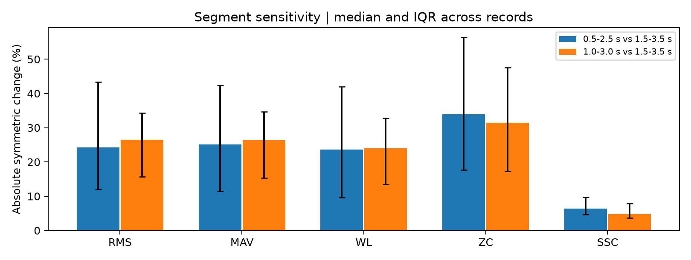
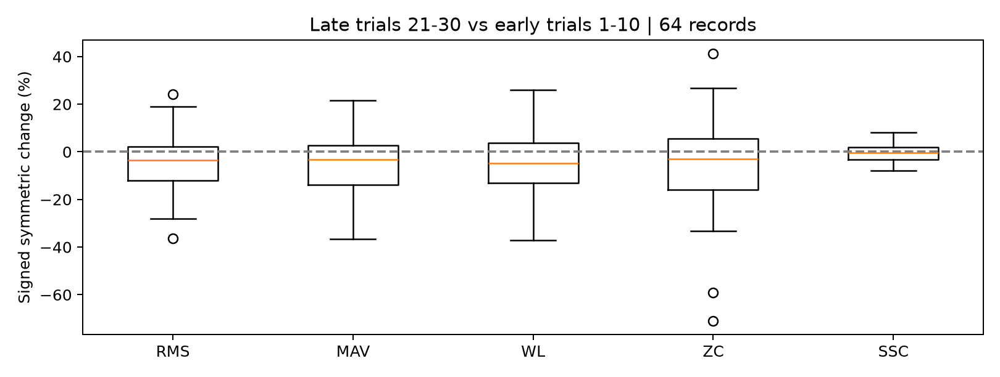
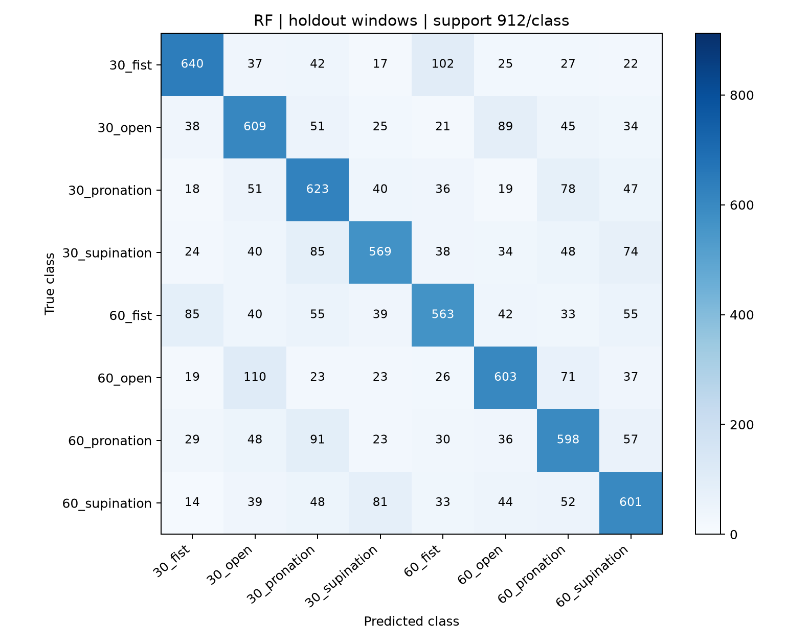

# sEMG 손동작·팔꿈치 각도 예측 — Step2

**1주차 데이터 이해·클래스 설계, 2주차 전처리·특징 추출, 3주차 모델 비교·통계 검정**의 과정과 결과를 정리한 저장소다.
8명의 5채널 sEMG로 손동작 4종과 팔꿈치 각도 2종을 조합한 8클래스를 구성한다.
25차원 특징 데이터셋을 구성하고 SVM·Random Forest·XGBoost를 동일한 시행 분할로 비교했다.

## 주차별 결과보고서

- [1주차 보고서 및 요약](reports/week1/README.md): 데이터 이해와 8클래스 설계.
- [2주차 최종 결과보고서 PDF](reports/week2/Step2_week2_report_OhSeongbin.pdf): 전처리·특징 추출과 안정성 추가 분석을 포함한 10페이지 보고서.
- [2주차 실행 노트북](week2_preprocessing.ipynb): 기본 실습의 코드와 실행 결과.
- [3주차 최종 결과보고서 PDF](reports/week3/Step2_week3_report_OhSeongbin.pdf): 모델 비교·통계 검정·혼동행렬·계산 비용과 한계.
- [3주차 수정 가능한 Word 보고서](reports/week3/Step2_week3_report_OhSeongbin.docx): 편집용 문서. PDF는 페이지 검수를 완료했으며 DOCX는 렌더러 부재로 페이지 배치를 별도 검증하지 못했다.
- [3주차 실행 결과 노트북](week3_model_comparison.ipynb) 및 [재현 안내](reports/week3/README.md).

## 1주차 핵심 결과 요약

1주차에는 데이터 구조를 파악하고 손동작과 팔꿈치 각도를 함께 표현하는 8클래스를 설계했다.
[1주차 전체 결과보고서 PDF](reports/week1/Step2_week1_report_OhSeongbin.pdf)에서 신호 그림과 RMS 비교 결과를 확인할 수 있다.

| 항목 | 1주차 확인 내용 |
|---|---|
| 데이터 구성 | 8명 × 8조건 = 연속 기록 64개 |
| 시행 구조 | 파일마다 마커 30개, 전체 1,920개, 클래스당 240개 |
| 신호 | 1,000 Hz, ECR·ED·FDS·Biceps·Triceps의 5채널 |
| 클래스 설계 | 30도·60도 × 주먹 쥐기·손 펴기·회내·회외 |
| 파일명 해석 | pro는 회내, extor는 회외 |
| 관찰 방법 | 마커 상승점 기준 5초 구간의 신호 확인과 채널별 RMS 비교 |
| 수행 범위 | 데이터 품질 검사와 클래스 설계, 모델 학습·평가는 미수행 |

CSV 하나를 단일 시행으로 보지 않고 **30회 시행을 포함하는 연속 기록**으로 해석했다.
공개 신호에 이미 필터가 적용되어 있어 중복 필터링하지 않았다.
마커가 실제 동작 시작을 뜻하는지는 확인되지 않았으며, 휴식을 포함하는 5초 RMS를 동작 구간만의 근활성으로 해석하지 않았다.

이 결과를 바탕으로 2주차에서는 시행 ID를 먼저 나누고, 잠정적인 2초 분석 구간에서 25차원 특징을 추출했다.

## 2주차 핵심 결과 요약

64개 연속 기록에서 1,920개 시행을 확인하고, RMS·MAV·WL·ZC·SSC를 5채널에서 추출했다.
200 ms 창과 50% 중첩을 사용해 시행당 19개, 총 36,480개의 25차원 특징 벡터를 생성했다.
시행을 먼저 나누어 학습 29,184개 / 테스트 7,296개 창을 구성했고, 동일 시행의 양쪽 분할 중복은 0건이다.
표준화는 학습 특징에만 fit했으며 특징·창 경계·분할·필터 검증 테스트 5개를 통과했다.

**추가 분석은 학습 시행 1,536개만 사용했다.** 기존 1.5~3.5초 구간과 다른 두 구간을 비교한
절대 대칭 변화율의 기록 간 중앙값은 다음과 같다.

| 특징 | 0.5~2.5초와 비교 | 1.0~3.0초와 비교 |
|---|---:|---:|
| RMS | 24.22% | 26.51% |
| MAV | 25.14% | 26.40% |
| WL | 23.63% | 23.93% |
| ZC | 33.87% | 31.44% |
| SSC | 6.43% | 4.72% |

절대 대칭 변화율은 `200 × |비교값 - 기준값| / (|비교값| + |기준값|)`이다.
두 값이 모두 0이면 0으로 처리하며 일반적인 증가율과 다르다.
각 시행의 19개 창 특징을 평균한 뒤 시행·채널별 변화율을 계산하고,
기록 내 시행 중앙값 → 채널 중앙값 → 64개 기록 중앙값 순서로 요약했다.
SSC는 이 비교에서 상대적으로 덜 민감했지만, 이것이 더 높은 분류 성능을 뜻하지는 않는다.

기록 후반(21~30회)과 초반(1~10회)을 비교한 RMS의 **부호 있는 대칭 변화율 중앙값은 -3.53%**였다.
64개 기록 중 43개는 감소하고 21개는 증가했으며, 사분위 범위는 -12.12~2.09%였다.
시간 비교는 기록·단계별 특징 중앙값의 채널별 변화율을 계산한 뒤 채널 중앙값으로 요약했다.
모든 기록에서 일관된 감소나 근피로가 확인된 것은 아니다.





64개 기록은 8명의 반복 측정이므로 독립적인 피험자 64명을 뜻하지 않는다.
추가 분석은 기술통계이며 유의성 검정이나 모델 성능 평가가 아니다.
분석 구간의 최적성 및 실제 동작 정렬은 미확인 상태이고, 기본 데이터셋은 변경하지 않았다.

추가 분석은 기본 데이터셋 생성 후 `python analyze_stability.py`로 재현한다.
[분석 요약](outputs/stability/summary.json), [구간별 수치](outputs/stability/segment_summary.csv),
[기록별 시간 변화](outputs/stability/record_time_changes.csv),
[정규화 RMS 그림](outputs/stability/envelope.png)을 함께 제공한다.

## 데이터와 1주차 연결

- 출처: [sEMG Hand Gesture and Elbow Angle Dataset](https://github.com/TestUser-alt-dev/sEMG-Hand-Gesture-Elbow-Angle-Dataset)
- 사용 버전: `cb64ded658b83ae97e6388dd373efad0e97bc47c`
- 참고 논문: *Simultaneous Classification of Hand Gestures and Elbow Angles Using sEMG Signals: A Comparison of Machine Learning Performances*, DOI: [10.1007/s13534-026-00607-7](https://doi.org/10.1007/s13534-026-00607-7). 서지 정보는 데이터 저장소의 설명을 따른다.
- 1주차 사용자 결과보고서: `Step2_1주차_결과보고서_오성빈.pdf` (2026-10-12).
- 실습 설정: 사용자 제공 `Step2_2주차_강의와실습.pptx`.
- 원본 CSV 한 개는 단일 시행이 아닌 **한 피험자·조건의 연속 기록**이다. 64개 기록마다 30개의 마커가 있다.
- 1,000 Hz, 신호 열 `bandpass 1`~`bandpass 5`; 채널은 ECR, ED, FDS, Biceps, Triceps 순서다.
- `pro` → 회내(pronation), `extor` → 회외(supination).
- 클래스 순서: `30_fist, 30_open, 30_pronation, 30_supination, 60_fist, 60_open, 60_pronation, 60_supination`.

원본 데이터는 다운로드 후 로컬에서 사용한다. 데이터 저장소의 연구용 사용 안내 및 논문 인용 요청을 따른다.
기존 Step1 손바닥 사용자 식별 프로젝트와 별개의 프로젝트다.

## 처리 방법과 재현 범위

1. 파일명과 신호·시간·마커 열을 검증한다. 첫 행의 마커도 포함하여 0→1 상승 위치를 찾는다.
2. `파일명#마커순번`을 시행 ID로 삼아 **시행을 먼저** 학습 80%, 테스트 20%로 층화 분할한다(seed=42).
3. 마커 이후 최대 5초를 관찰하되 다음 마커를 넘지 않도록 잘라 4,999표본 간격에서도 인접 시행과 표본을 공유하지 않는다.
4. 마커 기준 **1.5–3.5초**를 분석 구간으로 자른다. 이는 강의의 잠정 가정이다. 마커의 의미와 실제 동작 시작 정렬, 논문의 정확한 2초 시작점은 아직 확인되지 않았다.
5. 200 ms 창, 100 ms 간격으로 시행당 19개 창을 얻는다.
6. RMS·MAV·WL·ZC·SSC를 채널별로 계산해 25차원 벡터를 만든다. ZC 문턱값 0.01, SSC는 별도 문턱값 없이 기울기 부호 변화 수를 센다.
7. StandardScaler를 학습 특징에만 fit하고 테스트 특징에는 transform만 수행한다.

공개 CSV는 이미 60 Hz notch 및 20–450 Hz 4차 Butterworth 필터를 거친 데이터다.
기본 `already-filtered` 모드에서는 추가 필터를 적용하지 않는다.
강의의 Q=30, filtfilt 추가 필터 실습은 별도 PSD·표준편차 비교로 제공한다.
`refilter-demo` 모드로 생성한 데이터셋은 추가 필터 실험이며 기본 결과와 구분해야 한다.
필터는 시행마다 독립적으로 적용하므로 테스트 시행을 학습 시행과 이어 붙여 필터링하지 않는다.

같은 피험자와 연속 기록의 서로 다른 시행은 양쪽 분할에 존재한다. 이 분할로 새 피험자 또는 새 기록에 대한 일반화를 주장할 수 없다.
모델 성능, Confusion Matrix 및 논문 성능 수치 재현은 아직 수행하지 않았다.

## 실행 방법

Python 3.12 권장. 프로젝트 폴더에서 다음을 실행한다(Windows PowerShell).

```powershell
python -m venv .venv
.\.venv\Scripts\python.exe -m pip install -r requirements.txt
git clone https://github.com/TestUser-alt-dev/sEMG-Hand-Gesture-Elbow-Angle-Dataset.git data/source
git -C data/source checkout cb64ded658b83ae97e6388dd373efad0e97bc47c
.\.venv\Scripts\python.exe -m unittest -v test_week2
.\.venv\Scripts\python.exe week2.py
```

`week2_preprocessing.ipynb`는 실행 결과를 포함한다. 다시 실행하려면 설치한 환경을 노트북 커널로 선택해 모든 셀을 실행한다.
전체 데이터셋 생성 셀은 기존 기본 출력 파일을 다시 만든다.

추가 필터 실험 또는 분석 시작점 변경은 별도 출력 폴더를 사용한다.

```powershell
.\.venv\Scripts\python.exe week2.py --filter-mode refilter-demo --output-dir outputs/refilter_demo
.\.venv\Scripts\python.exe week2.py --segment-start 1000 --output-dir outputs/start_1000
```

## 파일 구성

| 파일 | 역할 |
|---|---|
| `week2.py` | 원자료 검증, 시행 분할, 필터 비교, 창 생성, 특징 추출, 표준화·저장 |
| `week2_preprocessing.ipynb` | 한국어 설명과 실제 실행 결과가 포함된 실습 노트북 |
| `test_week2.py` | 특징 수식·문턱값·창 경계·층화 분할·필터 검증 |
| `make_notebook.py` | 노트북 원본 생성 도구; 실행하면 기존 노트북의 출력이 초기화됨 |
| `outputs/week2/dataset.npz` | 학습·테스트 특징과 레이블, 시행·피험자 ID, 스케일러 정보 (로컬 생성) |
| `outputs/week2/trials.csv` | 시행 ID, 시작·끝, 클래스, 분할 정보 |
| `outputs/week2/windows.csv` | 각 특징 행의 원본 파일·시행·창 위치 추적 정보 |
| `outputs/week2/summary.json` | 설정, 입력 파일 SHA-256, 데이터 크기 및 검증 수치 |
| `outputs/week2/class_distribution.csv` | 클래스별 학습·테스트 창 수 |
| `outputs/week2/filter_and_segment.png` | 학습 시행의 잠정 분석 구간과 추가 필터 PSD 비교 |
| `outputs/week2/filter_std.csv` | 5채널의 추가 필터 적용 전후 표준편차 |
| `outputs/week2/environment.json` | 실제 실행에 사용한 주요 패키지 버전 |

원본 데이터와 생성된 NPZ는 Git 추적에서 제외한다. 노트북과 실행 코드로 재생성하고, 과제에서 요구하는 NPZ는 별도 제출한다.

## 2주차 결과

| 구분 | 시행 수 | 창 수 | 특징 수 |
|---|---:|---:|---:|
| 학습 | 1,536 | 29,184 | 25 |
| 테스트 | 384 | 7,296 | 25 |
| 전체 | 1,920 | 36,480 | 25 |

8개 클래스 각각 학습 3,648개, 테스트 912개 창이다. 동일 시행의 학습·테스트 중복은 0이다.
비상수 특징은 학습 데이터에서 평균 0, 표준편차 1인지 검증한다. 상수 특징은 표준화 후 0으로 처리한다.
상세 수치와 PSD 비교는 실행 노트북 및 `summary.json`에서 확인한다.

200 ms 창은 짧은 시간 구간의 근활성 특징을 계산하면서 시간 변화를 추적하기 위한 실습 설정이다.
50% 중첩은 시간 해상도를 높이지만 독립 표본 수를 19배로 늘린다는 의미는 아니다.
해당 설정의 최적성을 비교하는 실험은 수행하지 않았다.

## 3주차 모델 비교 결과

2주차 데이터셋과 고정된 강의 파라미터로 세 모델을 학습했다. 테스트 데이터로 설정을 조정하지 않았으며,
아래 지표는 **윈도우 단위 홀드아웃 결과**다. Precision·Recall·F1은 macro 평균, 단위는 %다.

| 모델 | Accuracy | Precision | Recall | F1 |
|---|---:|---:|---:|---:|
| SVM | 49.62 | 50.07 | 49.62 | 49.64 |
| RF | **65.87** | **66.09** | **65.87** | **65.90** |
| XGBoost | 64.10 | 64.44 | 64.10 | 64.15 |

RF가 이번 홀드아웃에서 가장 높은 Macro F1을 보였다. 모든 모델에서 같은 각도의 다른 동작으로 오분류한
건수가 세 오류 범주 중 가장 많았고, 특정 방향에서는 같은 동작의 각도 혼동도 두드러졌다.
RF의 최다 오분류 방향은 `60_open → 30_open` 110건이었다.

### 학습 데이터 내부 5-fold 교차검증

학습 시행 1,536개를 층화 분할한 뒤 각 시행의 창들을 같은 fold에 배정했다.
각 모델에 동일한 fold를 적용했고 StandardScaler는 해당 fold의 학습 부분에서만 fit했다.
표준편차는 강의 코드와 같은 `ddof=0`이며 단위는 %다.

| 모델 | Fold 1 | Fold 2 | Fold 3 | Fold 4 | Fold 5 | 평균 ± 표준편차 |
|---|---:|---:|---:|---:|---:|---:|
| SVM | 46.26 | 46.22 | 45.89 | 49.46 | 46.46 | 46.86 ± 1.31 |
| RF | 61.59 | 63.26 | 63.48 | 63.93 | 64.75 | 63.40 ± 1.04 |
| XGBoost | 60.83 | 62.08 | 62.11 | 63.00 | 61.82 | 61.97 ± 0.69 |

### 대응표본 t-검정과 해석

| 모델 쌍 | 원 p값 | Holm 보정 p값 |
|---|---:|---:|
| SVM / RF | 0.00002049 | 0.00004099 |
| SVM / XGBoost | 0.000006017 | 0.00001805 |
| RF / XGBoost | 0.02122 | 0.02122 |

세 쌍 모두 명목 유의수준 0.05에서 차이가 검출되었다. 다만 fold 간 학습 데이터가 겹치고 대응쌍은
5개뿐이므로 **탐색적인 결과**로 해석한다. Holm 보정은 다중 비교를 다루지만 fold 의존성을 해결하지 않는다.
강의에서 소개한 논문 RF 96.72 ± 0.58% 및 비유의한 차이와 본 실험의 결과는 다르다.
분석 구간·특징 정의·교차검증 범위·실행 설정 등의 차이가 가능하며, 원인을 확정하지 않았다.

### 혼동행렬과 계산 비용



[SVM 혼동행렬](outputs/week3/confusion_SVM.png) · [XGBoost 혼동행렬](outputs/week3/confusion_XGB.png)

| 모델 | 학습 시간 (s) | 단일 창 평균 추론 (ms) | 배치 추론 (ms/창) |
|---|---:|---:|---:|
| SVM | 19.173 | 1.564 | 1.3693 |
| RF | 2.031 | 12.527 | 0.0051 |
| XGBoost | 5.370 | 0.734 | 0.0083 |

단일 창 추론은 표준화 포함 Pipeline을 10회 예열한 뒤 동일 창으로 100회 호출해 측정했다.
RF·XGBoost는 CPU 4개 작업 스레드이며 GPU는 사용하지 않았다. 단일 창 호출과 배치 추론은 다른 지표이고,
RF의 단일 창 시간에는 병렬 호출 관리 비용 등이 영향을 줄 수 있다. 센서 입력·특징 추출 시간은 제외했다.
기존 피험자·연속 기록이 분할 양쪽에 존재하므로 새 피험자 일반화, 실제 배포 지연시간 또는 생리적 원인을
이 결과만으로 주장할 수 없다. [전체 설정·버전](outputs/week3/config.json)과 [수치 원본](outputs/week3/results.json)을 제공한다.

### 3주차 실행

```powershell
.\.venv\Scripts\python.exe -m pip install -r requirements-week3.txt
.\.venv\Scripts\python.exe -m unittest -v test_week2 test_week3
.\.venv\Scripts\python.exe week3.py
.\.venv\Scripts\python.exe verify_week3.py
```

완전히 새로 학습하려면 `python week3.py --output outputs/week3_new`를 사용한다.
기본 출력 폴더에 같은 설정의 fold 결과가 있으면 CV를 재사용하고 최종 홀드아웃 모델은 다시 학습한다.
추가 실험으로 테스트 결과에 맞춰 파라미터를 조정하지 않는다.

## 교차검증과 데이터 누수 방지

`dataset.npz`의 기본 키는 `Xtr, ytr, Xte, yte`다. 추가로 `Xtr_raw, Xte_raw`,
`groups_tr, groups_te`, `subjects_tr, subjects_te`, 특징·클래스 이름과 스케일러 통계를 저장한다.
`np.load(path, allow_pickle=False)`로 안전하게 읽을 수 있다.

이번 구현은 **Xtr_raw + groups_tr**에서 고유 시행 ID에 StratifiedKFold를 적용한 뒤 창으로 확장하여
시행 그룹을 보존한다. StandardScaler를 각 fold의 Pipeline 안에서 fit한다. 전체 학습 데이터로 이미 표준화한 Xtr를
그대로 교차검증에 사용하면 검증 fold의 통계가 섞인다. 테스트 세트는 최종 평가까지 보관한다.
동일 시행의 중첩 창을 독립 반복 실험으로 간주하거나 창별 점수만으로 유의성을 주장하지 않는다.
