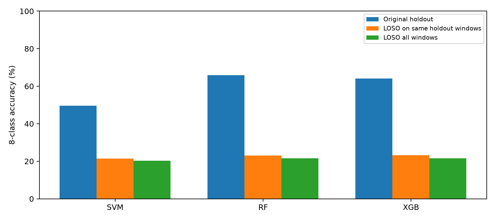
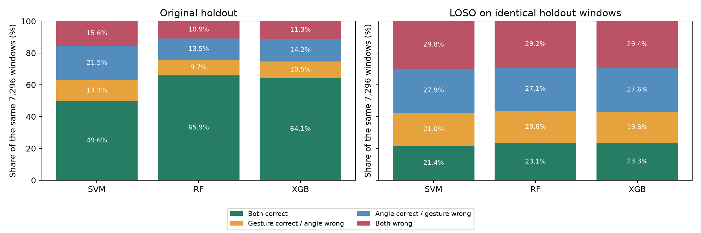
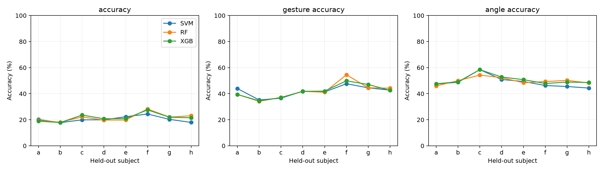
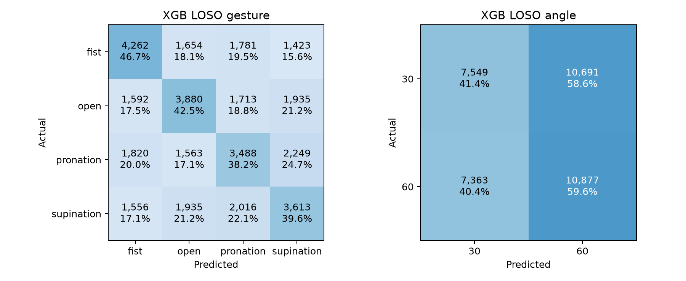

# 오류 분해와 피험자 제외 평가 실험 결과

오성빈 · 2026-10-21
## 실험 질문과 조건

손동작과 각도 중 어떤 정보에서 오류가 발생하는가? 기존 피험자의 다른 시행을 평가하던 조건을 학습에서 완전히 제외한 사람을 평가하는 조건으로 바꾸면 성능과 오류 구조가 어떻게 달라지는가?

신규 인체 측정 없이 기존 8명의 36,480개 창(1,920시행)을 사용했다. 2주차의 표준화 전 25차원 특징과 1.5~3.5초 분석 구간, 3주차의 고정 모델 설정을 유지했다. 7명 31,920창을 학습하고 남은 1명 4,560창을 평가하는 LOSO를 8회, 세 모델에 대해 총 24회 수행했다.

각 fold의 StandardScaler는 학습 피험자만으로 fit했다. 데이터셋 해시, 설정, fold별 결과와 예측을 저장했다. 기본 3주차 결과는 덮어쓰지 않았다. 기존 테스트도 별도의 LOSO 프로토콜에 통합하므로 이 실험은 새로운 미공개 데이터에 대한 독립적 확인 실험이 아닌 사후 탐색 실험이다.

## 1 기존 테스트의 오류 분해

각 모델은 8클래스 하나를 예측한다. 아래의 동작·각도 평가는 이 결합 예측을 분해한 것이며 별도의 동작 전용·각도 전용 모델을 학습한 결과가 아니다.

|모델|8클래스 정확도|손동작 정확도|각도 정확도|
|---|---|---|---|
|SVM|49.62%|62.87%|71.12%|
|RF|65.87%|75.60%|79.36%|
|XGB|64.10%|74.56%|78.28%|

|모델|둘 다 정답|손동작 정답·각도 오류|각도 정답·손동작 오류|둘 다 오류|
|---|---|---|---|---|
|SVM|3620|967|1569|1140|
|RF|4806|710|984|796|
|XGB|4677|763|1034|822|

모델별 합계는 7,296창이다. 동작·각도 개별 정확도가 8클래스 정확도보다 높아지는 것은 정답 조건을 분해한 결과이며 모델 개선을 의미하지 않는다. 오류 유형의 단순 건수는 동작 4종과 각도 2종의 과제 난이도가 같다는 전제 없이 해석해야 한다.

## 2 전체 LOSO 성능

|모델|8클래스 정확도|Macro F1|손동작 정확도|각도 정확도|피험자별 정확도 SD|
|---|---|---|---|---|---|
|SVM|20.35%|20.25%|41.73%|48.89%|2.04%|
|RF|21.59%|21.43%|42.11%|49.84%|2.96%|
|XGB|21.63%|21.52%|41.78%|50.51%|2.78%|

모든 피험자의 평가 창 수가 같아 합산 정확도와 피험자별 정확도의 평균은 같다. 표의 Macro F1은 전체 예측을 합산하여 계산했다. 피험자별 Macro F1 평균과는 다를 수 있으며 둘 다 CSV에 저장했다. SD는 8명 사이의 변동(ddof=0)이며 신뢰구간이 아니다.

|모델|둘 다 정답|손동작 정답·각도 오류|각도 정답·손동작 오류|둘 다 오류|
|---|---|---|---|---|
|SVM|7424|7798|10410|10848|
|RF|7877|7485|10303|10815|
|XGB|7890|7353|10536|10701|

각 모델의 합계는 36,480창이다. 기존 7,296창과 오류 건수 자체를 직접 비교하면 안 되며 동일 평가 창 비교 또는 비율을 사용해야 한다.

## 3 동일한 기존 테스트 창에서 비교

|모델|기존 정확도|LOSO 정확도|정확도 차이 pp|손동작 변화 pp|각도 변화 pp|
|---|---|---|---|---|---|
|SVM|49.62%|21.40%|-28.22|-20.52|-21.88|
|RF|65.87%|23.08%|-42.79|-31.91|-29.18|
|XGB|64.10%|23.27%|-40.83|-31.50|-27.44|

평가 창 7,296개를 정확히 맞춰 비교했다. 기존 모델은 8명의 다른 시행 29,184창으로 학습했고, 각 LOSO 모델은 평가 대상자를 뺀 7명의 31,920창으로 학습했다. 평가 표본 차이는 줄였지만 학습량·구성 차이는 남으므로 차이 전체를 개인차의 순수 인과 효과로 해석할 수 없다.





## 4 피험자별 결과

|평가 대상|SVM 정확도|RF 정확도|XGB 정확도|
|---|---|---|---|
|a|20.20%|19.54%|18.90%|
|b|17.76%|18.09%|17.85%|
|c|19.93%|22.19%|23.60%|
|d|19.96%|19.76%|20.75%|
|e|22.30%|19.80%|20.92%|
|f|24.41%|28.27%|27.54%|
|g|20.31%|22.04%|21.97%|
|h|17.94%|23.05%|21.49%|



## 5 결과 해석과 한계

기존 RF의 65.87% 정확도는 같은 평가 창에 대한 LOSO에서 23.08%로 낮아졌다. 이는 기존 조건의 높은 성능을 학습에서 제외된 사람에게 그대로 기대하기 어렵다는 관찰이다. 원인을 개인 생리 차이 하나로 특정하지 않는다.

전체 LOSO에서 손동작 정확도는 약 42%, 각도 정확도는 약 49~51%였다. 각도는 두 클래스의 균등 추측 기준 50%에 가깝고 손동작은 네 클래스의 기준 25%보다 수치상 높다. 따라서 원래 각도 정확도가 손동작 정확도보다 높았다는 사실만으로 각도 정보가 피험자를 넘어 더 잘 유지된다고 판단할 수 없다. 기준과의 차이에 대한 유의성 검정은 수행하지 않았다.

모델 순위의 의미도 달라졌다. 전체 LOSO에서 RF 21.59%와 XGBoost 21.63%의 차이는 약 0.04 pp에 불과하다. 이 미세한 차이를 일반적인 우월성으로 주장하지 않는다. 모델 교체보다 평가 대상과 측정 조건의 변화에 대응하는 문제가 더 크게 드러났다고 해석할 수 있다.

- SVM: 동일 테스트 창에서 정확도 변화는 -28.22 pp. 전체 LOSO의 평가 대상별 정확도 범위는 b 17.76% ~ f 24.41%였다.

- RF: 동일 테스트 창에서 정확도 변화는 -42.79 pp. 전체 LOSO의 평가 대상별 정확도 범위는 b 18.09% ~ f 28.27%였다.

- XGB: 동일 테스트 창에서 정확도 변화는 -40.83 pp. 전체 LOSO의 평가 대상별 정확도 범위는 b 17.85% ~ f 27.54%였다.


성능 변화는 평가 대상자를 학습에서 제외했을 때의 적용 범위를 보여준다. 피험자 차이와 개인별 측정 기록·전극 부착·동작 방식의 차이는 현재 자료에서 분리할 수 없다. 특정 사람의 성능이 낮다는 이유로 그 사람의 생리적 특성이나 데이터 품질에 문제가 있다고 단정하지 않는다.

동작·각도는 클래스 수와 우연 수준이 다르므로 두 정확도만으로 본질적인 난이도를 확정하지 않는다. 8클래스 균등 추측 기준은 12.5%, 동작은 25%, 각도는 50%이지만 이를 개인별 성능의 유의성 검정으로 사용하지 않았다.

새로운 사람 일반화의 검토는 이 8명과 기존 측정 조건 안에서의 제외 평가다. 새 날짜·전극 위치·새로운 각도 또는 동작에 대한 검증은 아니다. 중첩된 창은 독립 표본이 아니며 피험자는 8명뿐이다. fold 학습 집합도 겹치므로 창들을 독립 반복으로 간주한 유의성 검정은 수행하지 않았다.

기본 실험은 오류 분해와 LOSO이며, 후속 분석으로 시행별 다수결을 수행했다. 구간 최적화, 특징·채널 제거 또는 추가 데이터 수집은 수행하지 않았다. 성능을 본 뒤 설정을 조정하지 않았다.

## 재현과 검증

저장소 루트에서 기존 `requirements-week3.txt` 환경으로 실행한다.

```bash
python -m unittest -v test_loso
python experiment_loso.py
python verify_loso.py
python summarize_loso.py
```

`experiment_loso.py`는 동일 프로토콜의 완료된 피험자·모델 결과를 재사용한다. 프로토콜이 달라지면 오류로 중단한다. 입력은 `outputs/week2/dataset.npz`와 `outputs/week3/holdout_predictions.csv`이며 출력은 별도 `outputs/loso`에 저장한다.

`baseline_decomposition.csv`, `baseline_by_subject.csv`, `fold_metrics.csv`, `loso_summary.csv`, `matched_original_test.csv`, `predictions.csv` 및 모델별 8클래스·손동작·각도 혼동행렬 CSV로 수치를 추적할 수 있다.

## 후속 분석과 별도 결과보고서

- [LOSO 실험 결과보고서 PDF](../../reports/loso/LOSO_report_OhSeongbin.pdf)
- [편집 가능한 Word 보고서](../../reports/loso/LOSO_report_OhSeongbin.docx)
- [평가 방식별 비교표](../final/comparison.csv) 및 [시행별 투표 결과](../final/trial_predictions.csv)

후속 분석에서는 시행당 19개 결합 클래스 예측의 최다 득표를 선택했다. 동률이면 고정된 클래스 순서에서 앞선 값을 선택했다. RF의 기존 평가 정확도는 창 65.87%, 시행 96.09%였고, 같은 테스트 대상의 LOSO는 창 23.08%, 시행 31.51%였다. 전체 LOSO의 시행 정확도는 28.96%다. 시행 판단은 2초 구간 전체를 사용하므로 창 판단과 지연시간이 다르다.

전체 LOSO 각도 예측은 60도로 다소 치우쳤으나 양쪽 혼동이 모두 컸다. RF에서 30도 → 60도 오류는 10,252건, 반대 방향은 8,048건이다. 이것만으로 개인 생리 차이를 원인으로 확정할 수 없다.




후속 분석 재현 및 검증:

```bash
python analyze_final.py
python verify_final.py
```

최초 실행 시 `outputs/week2/dataset.npz`가 없다면 원자료 준비 후 `python week2.py`로 생성한다. 기본 환경과 원자료 준비 방법은 저장소의 기존 안내를 따른다. 보고서 재생성은 `requirements-report.txt` 설치 후 `python build_loso_report.py`로 수행한다.
